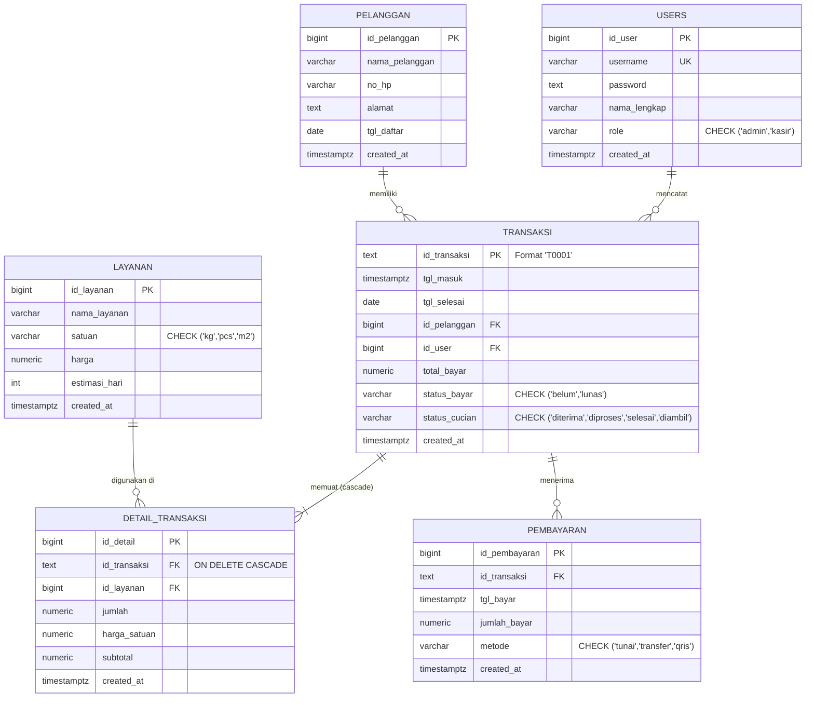

# LaundryGo - Sistem Informasi Pengelolaan Laundry

> **Project WEB 26 — Penilaian Akhir Individu**  
> **Nama Pengembang:** Athalia Calya Fitriani  
> **Judul Proyek:** Sistem Informasi Laundry  
> **Teknologi:** Node.js (Next.js 16 App Router) • React 19 • Supabase (PostgreSQL) • Tailwind CSS  
> **Repositori GitHub:** [https://github.com/athaliacalya/LaundryGo](https://github.com/athaliacalya/LaundryGo)

---

## 1. Deskripsi Proyek

**LaundryGo** adalah aplikasi sistem informasi berbasis web yang dirancang khusus untuk mengelola operasional bisnis laundry secara terpadu, cepat, dan transparan. 

Aplikasi ini menyelesaikan permasalahan operasional manual (buku nota fisik yang rawan hilang, risiko salah kalkulasi tarif, status cucian yang sulit dipantau pelanggan, serta ketiadaan pembukuan laporan pendapatan harian/bulanan). 

### Fitur Utama:
1. **Autentikasi Dua Peran (Role-Based Access)**: Hak akses terpisah antara **Administrator** (pemilik/manajemen) dan **Kasir** (petugas harian).
2. **Halaman Publik & Pelacakan Nota (Tracking)**: Pelanggan dapat memeriksa kemajuan pengerjaan cucian (Diterima ➔ Diproses ➔ Selesai ➔ Diambil) cukup dengan memasukkan Nomor Nota di halaman beranda.
3. **CRUD Pelanggan & Layanan Lengkap**: Pengelolaan data master disertai fitur **Pencarian instan** dan **Pagination** (10 data per halaman).
4. **Transaksi Multi-Layanan & Nota Otomatis**: Kasir dapat menambahkan beberapa paket cucian (kiloan, satuan, bed cover) dalam satu nota, penghitungan subtotal & estimasi tanggal selesai otomatis, serta pembuatan kode nota berurutan (`T0001`, `T0002`, dst.).
5. **Pencatatan Pembayaran Fleksibel**: Mendukung pembayaran bertahap (DP dan Pelunasan) dengan metode Tunai, Transfer, dan QRIS, disertai pembaruan status lunas otomatis.
6. **Cetak Nota & Laporan Pendapatan**:
   - **Nota Transaksi**: Format struk 1 lembar siap cetak langsung dari browser (`window.print`).
   - **Laporan Keuangan**: Filter rentang tanggal, ringkasan total omzet & jumlah nota, cetak/simpan PDF, serta ekspor file CSV (kompatibel Microsoft Excel).
7. **Keamanan & Standar Modern**:
   - Password di-hash menggunakan algoritma **Bcrypt** (10 salt rounds).
   - Seluruh query database berparameter (Prepared Statements via Supabase SDK).
   - Validasi data berlapis di sisi server (Server Actions) dan sisi peramban (HTML5 validation attributes).
   - Keamanan data melalui **Row Level Security (RLS)** pada Supabase.
8. **Desain Responsif (Mobile-First)**: Navigasi sidebar drawer, target tombol sentuh sentral (≥ 48px), ukuran font form 16px (mencegah auto-zoom iOS), dan tata letak tabel yang nyaman dibuka di layar HP (360px) hingga laptop.

---

## 2. Akun Demo (Untuk Pengujian & Penilaian)

Sistem telah dilengkapi dengan akun bawaan untuk kedua peran:

| Peran | Username | Password | Hak Akses Utama |
|---|---|---|---|
| **Administrator** | `admin` | `admin123` | Akses penuh: Dashboard analisis, CRUD Pelanggan, CRUD Layanan & Tarif, Transaksi, Laporan Keuangan (Cetak PDF & Ekspor Excel). |
| **Kasir** | `kasir1` | `kasir123` | Akses operasional: Input Transaksi Baru, CRUD Pelanggan, Cetak Nota Struk, Update Status Cucian & Bayar, Read-Only Layanan. |

> *(Password default di atas dibuat menggunakan skrip `scripts/hash-password.mjs`)*

---

## 3. Rancangan Database (Entity Relationship Diagram - ERD)

Aplikasi menggunakan database relasional PostgreSQL (Supabase) yang terdiri dari 6 tabel yang saling berelasi:



*Skema SQL lengkap, constraint, dan data seed dapat dilihat pada file [`schema_supabase.sql`](schema_supabase.sql).*

---

## 4. Panduan Menjalankan di Lokal (Local Setup)

### Prasyarat:
- [Node.js](https://nodejs.org/) versi 18.x, 20.x, atau 24.x
- [Git](https://git-scm.com/)

### Langkah-langkah:

1. **Clone Repositori:**
   ```bash
   git clone https://github.com/athaliacalya/LaundryGo.git
   cd LaundryGo
   ```

2. **Pasang Dependensi:**
   ```bash
   npm install
   ```

3. **Konfigurasi Environment (`.env.local`):**
   Salin atau buat file `.env.local` di root proyek dengan variabel berikut:
   ```env
   NEXT_PUBLIC_SUPABASE_URL=https://vyaacxnzfprwvfjpixwq.supabase.co
   NEXT_PUBLIC_SUPABASE_ANON_KEY=sb_publishable_...
   SUPABASE_SERVICE_ROLE_KEY=sb_secret_...
   SESSION_SECRET=kunci_rahasia_londri_2026_ganti_bebas_asal_panjang
   ```

4. **Inisialisasi Database:**
   Jika menggunakan project Supabase baru, jalankan query dari file `schema_supabase.sql` pada menu **SQL Editor** di dashboard Supabase Anda.

5. **Jalankan Aplikasi:**
   ```bash
   npm run dev
   ```
   Buka peramban di [http://localhost:3000](http://localhost:3000).

---

## 5. Panduan Deployment / Hosting

Aplikasi ini dibangun menggunakan **Node.js (Next.js App Router)** dan database **Supabase PostgreSQL**, sehingga sangat cocok di-hosting pada platform cloud modern:

1. **Database:** Dihosting di [Supabase](https://supabase.com) (PostgreSQL Cloud Serverless).
2. **Frontend & Backend API:** Dihosting di [Vercel](https://vercel.com):
   - Hubungkan akun GitHub ke Vercel.
   - Pilih repositori `athaliacalya/LaundryGo`.
   - Masukkan Environment Variables (`NEXT_PUBLIC_SUPABASE_URL`, `SUPABASE_SERVICE_ROLE_KEY`, `SESSION_SECRET`).
   - Klik **Deploy**. Website akan langsung aktif dengan HTTPS gratis.

---

## 6. Pemetaan Ketentuan Tugas (Project WEB 26)

| No | Ketentuan Tugas | Implementasi di LaundryGo | Status |
|:---:|---|---|:---:|
| 1 | **Bahasa / Framework** | Menggunakan framework **Node.js (Next.js 16)** dengan arsitektur Server Components & Server Actions. | Terpenuhi |
| 2 | **Git & GitHub** | Repositori GitHub aktif sejak awal dengan riwayat commit deskriptif per modul. | Terpenuhi |
| 3 | **Minimal 2 Peran & CRUD** | Peran **Admin** dan **Kasir**; CRUD Pelanggan, Layanan, dan Transaksi; dilengkapi **Pencarian** & **Pagination 10 data**. | Terpenuhi |
| 4 | **Laporan Cetak / Ekspor** | Laporan Pendapatan di `/admin/laporan` dapat **Dicetak / Simpan PDF** dan **Diekspor ke CSV (Excel)**, serta fitur **Cetak Nota**. | Terpenuhi |
| 5 | **Keamanan Dasar** | Password di-hash dengan **Bcrypt**, Prepared Statement via Supabase SDK, validasi input sisi server & browser, Row Level Security (RLS). | Terpenuhi |
| 6 | **Tampilan Responsif** | Tampilan fleksibel dan nyaman diakses di smartphone (layar 360px), tablet, hingga laptop. | Terpenuhi |
| 7 | **Judul Resmi** | Terdaftar resmi di No. 1: **ATHALIA CALYA FITRIANI — Sistem Informasi Laundry**. | Terpenuhi |
| 8 | **README, ERD, Demo** | Dokumentasi lengkap dengan diagram ERD Mermaid, kredensial akun demo, dan panduan teknis. | Terpenuhi |
| 9 | **Video Demo (2–3 Menit)** | Tersedia skenario alur perekaman demo yang terstruktur. | Terpenuhi |

---

## 7. Skenario Video Demo (Durasi Target: 2:30 Menit)

Jika Anda ingin merekam video demo penilaian, ikuti urutan alur berikut:

- **Menit 0:00 – 0:25 (Pengenalan & Halaman Utama)**:
  - Tampilkan halaman Beranda (`UI Index`), jelaskan judul proyek "Sistem Informasi Laundry - LaundryGo", serta demonstrasikan fitur publik **Cek Status Cucian** dengan memasukkan nomor nota.
- **Menit 0:25 – 1:10 (Alur Kasir)**:
  - Masuk sebagai Kasir (`kasir1`).
  - Buka menu Pelanggan ➔ Tambah Pelanggan Baru.
  - Buat Transaksi Baru dengan memilih 2 jenis layanan (kiloan + satuan). Tunjukkan kalkulasi otomatis subtotal & estimasi tanggal selesai.
  - Catat Pembayaran DP, lalu klik **Cetak Nota** (tunjukkan tampilan preview print 1 lembar).
- **Menit 1:10 – 1:35 (Status Cucian & Batasan Hak Akses)**:
  - Ubah status cucian menjadi "Diproses" ➔ "Selesai".
  - Tunjukkan bahwa kasir **tidak memiliki akses** ke menu Laporan Pendapatan (keamanan route protection).
- **Menit 1:35 – 2:10 (Alur Administrator)**:
  - Logout kasir, login sebagai Admin (`admin`).
  - Tunjukkan Dashboard ringkasan pendapatan hari ini dan cucian diproses.
  - Buka menu Laporan Pendapatan, atur filter tanggal, tunjukkan tombol **Cetak / Simpan PDF** dan tombol **Ekspor CSV (Excel)**.
- **Menit 2:10 – 2:30 (Responsif HP & Penutup)**:
  - Buka Inspect Element / mode HP (360px) untuk menunjukkan sidebar drawer dan tombol yang tetap rapi.
  - Tunjukkan sekilas repositori GitHub dengan riwayat commit, lalu tutup presentasi.

---
*Dibuat dengan bangga untuk Penilaian Akhir Project WEB 26.*
