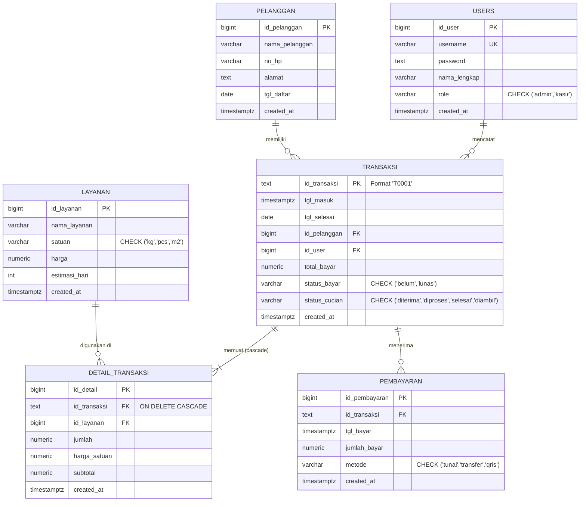
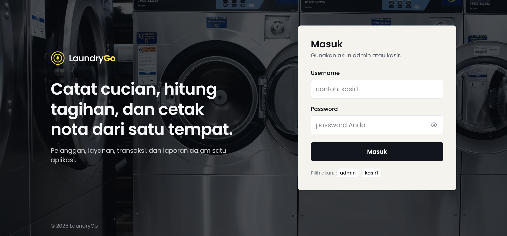
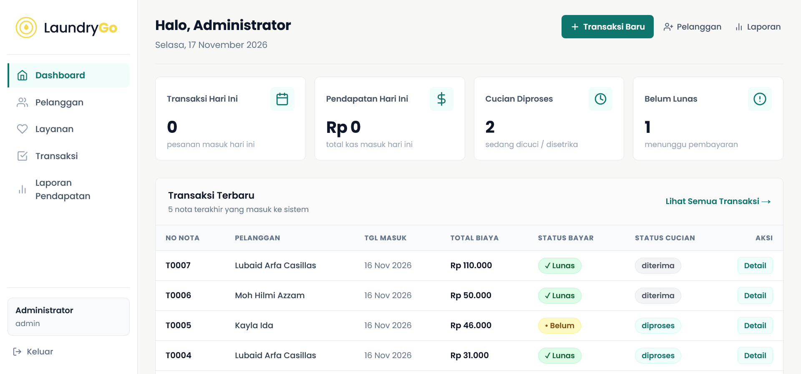
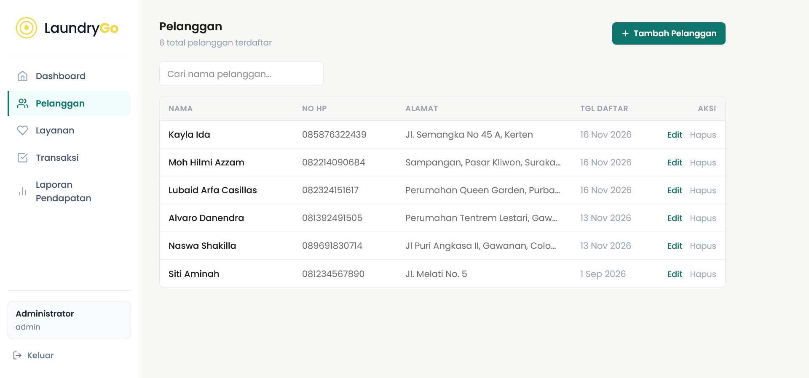
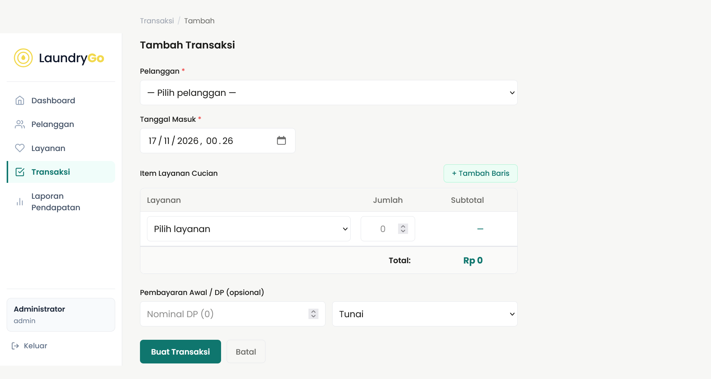
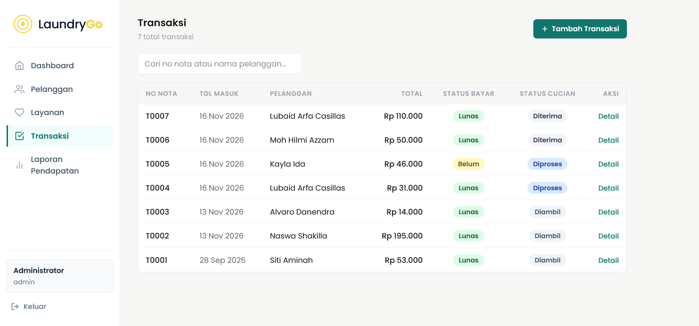
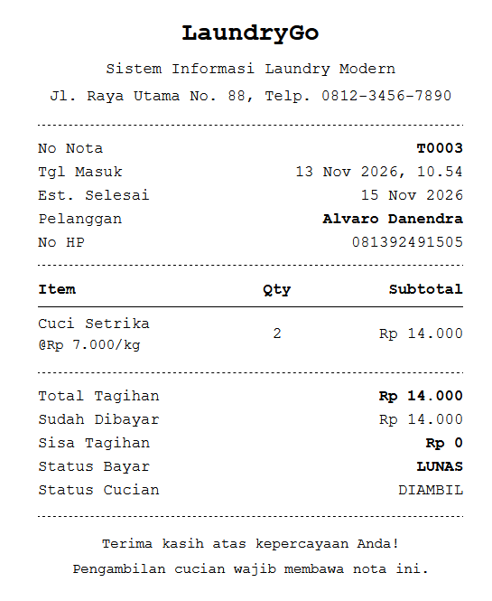
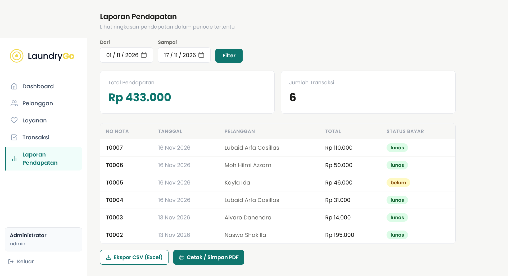
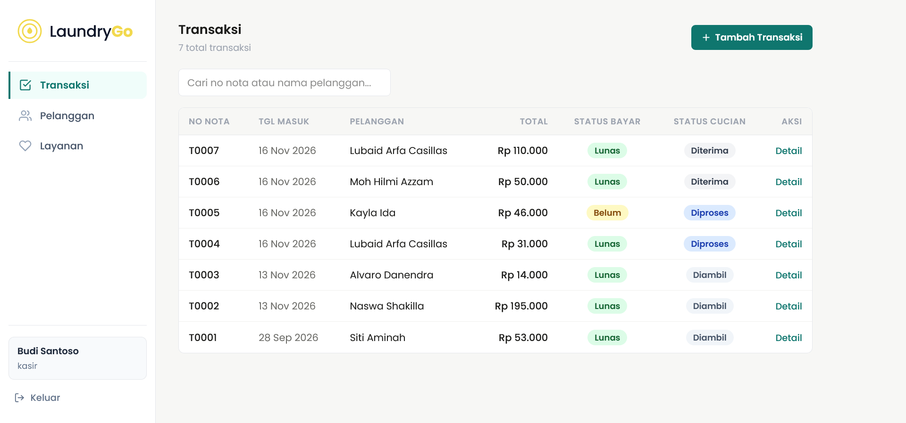

# LaundryGo - Sistem Informasi Pengelolaan Laundry

> **Project WEB 26 — Penilaian Akhir Individu**  
> **Nama Pengembang:** Athalia Calya Fitriani  
> **Judul Proyek:** Sistem Informasi Laundry  
> **Teknologi:** Node.js (Next.js 16 App Router) • React 19 • Supabase (PostgreSQL) • Tailwind CSS  
> **Live Website:** [https://laundrygo.web.id](https://laundrygo.web.id) *(Mirror: [https://laundry-go-wine.vercel.app](https://laundry-go-wine.vercel.app))*  
> **Repositori GitHub:** [https://github.com/athaliacalya/LaundryGo](https://github.com/athaliacalya/LaundryGo)

---

## 1. Deskripsi Proyek

**LaundryGo** adalah aplikasi sistem informasi berbasis web yang dirancang khusus untuk mengelola operasional bisnis laundry secara terpadu, cepat, dan transparan. 

Aplikasi ini menyelesaikan permasalahan operasional manual (buku nota fisik yang rawan hilang, risiko salah kalkulasi tarif, status cucian yang sulit dipantau pelanggan, serta ketiadaan pembukuan laporan pendapatan harian/bulanan). 

### Fitur Utama:
1. **Autentikasi Dua Peran (Role-Based Access)**: Hak akses terpisah antara **Administrator** (pemilik/manajemen) dan **Kasir** (petugas harian).
2. **Halaman Publik & Pelacakan Nota (Tracking)**: Pelanggan dapat memeriksa kemajuan pengerjaan cucian (Diterima ➔ Diproses ➔ Selesai ➔ Diambil) cukup dengan memasukkan Nomor Nota di halaman beranda.
3. **CRUD Pelanggan & Layanan Lengkap**: Pengelolaan data master disertai fitur **Pencarian instan** dan **Pagination** (10 data per halaman).
4. **Transaksi Multi-Layanan & Nota Otomatis**: Kasir dapat menambahkan beberapa paket cucian (kiloan, satuan, bed cover) dalam satu nota, penghitungan subtotal & estimasi tanggal selesai otomatis, serta pembuatan kode nota berurutan (`T0001`, `T0002`, dst.).
5. **Pencatatan Pembayaran Fleksibel**: Mendukung pembayaran bertahap (DP dan Pelunasan) dengan metode Tunai, Transfer, dan QRIS, disertai pembaruan status lunas otomatis.
6. **Cetak Nota & Laporan Pendapatan**:
   - **Nota Transaksi**: Format struk 1 lembar siap cetak langsung dari browser (`window.print`).
   - **Laporan Keuangan**: Filter rentang tanggal, ringkasan total omzet & jumlah nota, cetak/simpan PDF, serta ekspor file CSV (kompatibel Microsoft Excel).
7. **Keamanan & Standar Modern**:
   - Password di-hash menggunakan algoritma **Bcrypt** (10 salt rounds).
   - Seluruh query database berparameter (Prepared Statements via Supabase SDK).
   - Validasi data berlapis di sisi server (Server Actions) dan sisi peramban (HTML5 validation attributes).
   - Keamanan data melalui **Row Level Security (RLS)** pada Supabase.
8. **Desain Responsif (Mobile-First)**: Navigasi sidebar drawer, target tombol sentuh sentral (≥ 48px), ukuran font form 16px (mencegah auto-zoom iOS), dan tata letak tabel yang nyaman dibuka di layar HP (360px) hingga laptop.

---

## 2. Akun Demo (Untuk Pengujian & Penilaian)

Sistem telah dilengkapi dengan akun bawaan untuk kedua peran:

| Peran | Username | Password | Hak Akses Utama |
|---|---|---|---|
| **Administrator** | `admin` | `admin123` | Akses penuh: Dashboard analisis, CRUD Pelanggan, CRUD Layanan & Tarif, Transaksi, Laporan Keuangan (Cetak PDF & Ekspor Excel). |
| **Kasir** | `kasir1` | `kasir123` | Akses operasional: Input Transaksi Baru, CRUD Pelanggan, Cetak Nota Struk, Update Status Cucian & Bayar, Read-Only Layanan. |

> *(Password default di atas dibuat menggunakan skrip `scripts/hash-password.mjs`)*

---

## 3. Rancangan Database (Entity Relationship Diagram - ERD)

Aplikasi menggunakan database relasional PostgreSQL (Supabase) yang terdiri dari 6 tabel yang saling berelasi:



*Skema SQL lengkap, constraint, dan data seed dapat dilihat pada file [`schema_supabase.sql`](schema_supabase.sql).*

---

## 4. Panduan Menjalankan di Lokal (Local Setup)

### Prasyarat:
- [Node.js](https://nodejs.org/) versi 18.x, 20.x, atau 24.x
- [Git](https://git-scm.com/)

### Langkah-langkah:

1. **Clone Repositori:**
   ```bash
   git clone https://github.com/athaliacalya/LaundryGo.git
   cd LaundryGo
   ```

2. **Pasang Dependensi:**
   ```bash
   npm install
   ```

3. **Konfigurasi Environment (`.env.local`):**
   Salin atau buat file `.env.local` di root proyek dengan variabel berikut:
   ```env
   NEXT_PUBLIC_SUPABASE_URL=https://vyaacxnzfprwvfjpixwq.supabase.co
   NEXT_PUBLIC_SUPABASE_ANON_KEY=sb_publishable_...
   SUPABASE_SERVICE_ROLE_KEY=sb_secret_...
   SESSION_SECRET=kunci_rahasia_londri_2026_ganti_bebas_asal_panjang
   ```

4. **Inisialisasi Database:**
   Jika menggunakan project Supabase baru, jalankan query dari file `schema_supabase.sql` pada menu **SQL Editor** di dashboard Supabase Anda.

5. **Jalankan Aplikasi:**
   ```bash
   npm run dev
   ```
   Buka peramban di [http://localhost:3000](http://localhost:3000).

---

## 5. Panduan Deployment / Hosting

Aplikasi ini dibangun menggunakan **Node.js (Next.js App Router)** dan database **Supabase PostgreSQL**, sehingga sangat cocok di-hosting pada platform cloud modern:

1. **Database:** Dihosting di [Supabase](https://supabase.com) (PostgreSQL Cloud Serverless).
2. **Frontend & Backend API:** Dihosting di [Vercel](https://vercel.com):
   - Hubungkan akun GitHub ke Vercel.
   - Pilih repositori `athaliacalya/LaundryGo`.
   - Masukkan Environment Variables (`NEXT_PUBLIC_SUPABASE_URL`, `NEXT_PUBLIC_SUPABASE_ANON_KEY`, `SUPABASE_SERVICE_ROLE_KEY`, `SESSION_SECRET`).
   - Sambungkan Custom Domain: **`laundrygo.web.id`**.
   - Klik **Deploy**. Website aktif dengan HTTPS/SSL otomatis.

---

## 6. Tangkapan Layar Aplikasi (Screenshots)

Berikut adalah dokumentasi visual antarmuka sistem **LaundryGo**:

### 1. Halaman Masuk (Login)
> Antarmuka autentikasi petugas dengan pilihan akun cepat (`admin` dan `kasir1`).


---

### 2. Dashboard Administrator
> Ringkasan metrik harian (Transaksi Hari Ini, Pendapatan Hari Ini, Cucian Diproses, Belum Lunas) dan tabel 5 transaksi terbaru.


---

### 3. Manajemen Pelanggan (CRUD, Pencarian & Pagination)
> Pengelolaan data master pelanggan dengan kotak pencarian instan dan navigasi halaman.


---

### 4. Form Transaksi Baru (Multi-Layanan & Kalkulasi Otomatis)
> Formulir pemesanan dengan penambahan beberapa item cucian sekaligus, kalkulasi total otomatis, dan opsi DP.


---

### 5. Detail Transaksi & Riwayat Pembayaran
> Rincian nota cucian, riwayat pembayaran bertahap, serta kontrol perubahan status pengerjaan.


---

### 6. Pratinjau Cetak Nota Struk
> Format cetak nota ringkas satu lembar siap cetak langsung ke printer kasir atau disimpan sebagai PDF.
<p align="center">
  
</p>

---

### 7. Laporan Pendapatan (Filter Tanggal, Cetak PDF & Ekspor Excel)
> Rekapitulasi omzet dengan filter periode tanggal WIB, cetak dokumen PDF, serta ekspor file CSV (Excel).


---

### 8. Antarmuka Kasir (Perbedaan Hak Akses)
> Tampilan operasional kasir dengan menu terisolasi (tanpa menu Laporan Pendapatan).


---